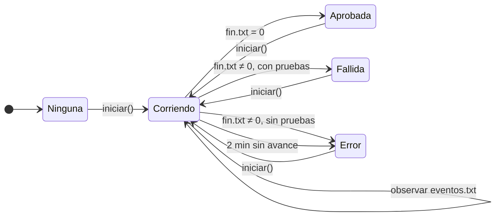
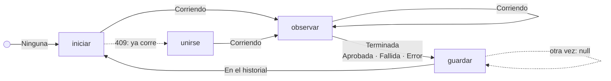

# Ejecución de pruebas: dos vistas

La misma máquina (`App\Enums\EstadoEjecucion`, manejada por `App\Support\Ejecucion`) vista de dos formas.

## 1. Diagrama de estados

Los nodos son estados; las flechas, operaciones. Responde: ¿en qué estado está? ¿Cómo llego de X a Y?

## 2. Diagrama de operaciones

Los nodos son operaciones; los cables, lo que cada una recibe y devuelve. Responde: ¿qué puedo hacer ahora? ¿En qué estado puedo hacer Z?

## Qué se puede en cada estado

| Estado | Se puede | Se rechaza |
|---|---|---|
| Ninguna | `iniciar()`, `correrYEsperar()` | `guardar()` → null |
| Corriendo | observar `public/ejecucion/eventos.txt`, `estado()`; otra pestaña se une con el 409 | `iniciar()` → 409; `correrYEsperar()` → "Ya hay una ejecución en curso"; `guardar()` → null |
| Aprobada · Fallida · Error | `guardar()` una vez; `iniciar()`, `correrYEsperar()` | `guardar()` otra vez → null |

Las guardias son en tiempo de ejecución: el estado vive en archivos, en la base y en otras pestañas.
